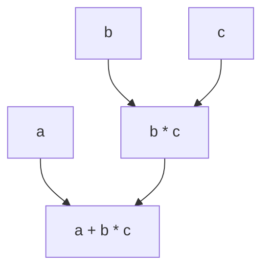
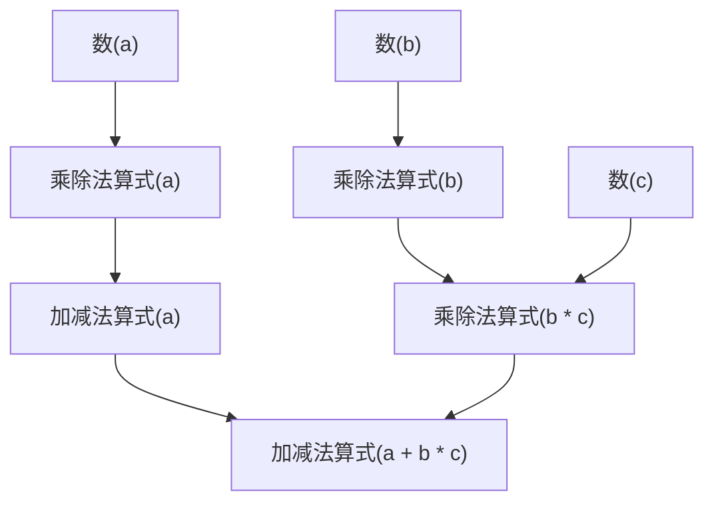
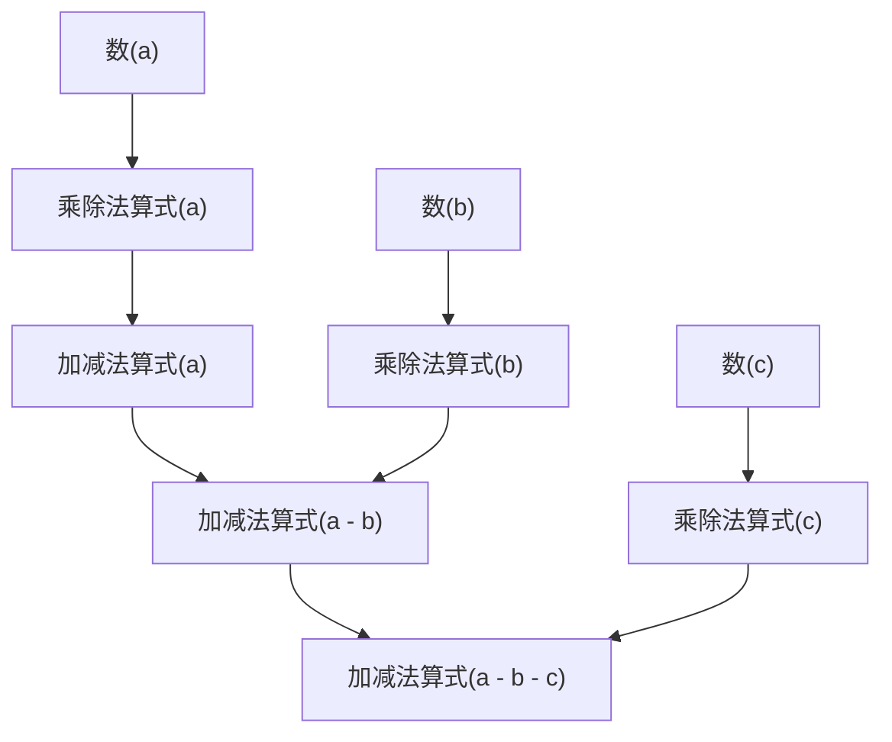

表达式是组成 C++ 程序的基本元素之一。**表达式**表示一个计算过程，可以用来计算一个值，以及产生其他影响程序状态的副作用。

在编译器处理表达式的时候，换行符如同空格一样，当做空白字符处理。因此，换行符不会影响表达式的语义。

## 操作数

表达式常常由数个表达式和一个运算符组合而成。为了方便理解，我们将这样由运算符和表达式组成的表达式，其中的表达式称为**操作数**。

对于操作数只有一个的表达式，有如下的形式：
```cpp
+a // `+` 是运算符，`a` 是操作数
```

对于运算符位于两个操作数之间的表达式，有如下的形式：
```cpp
a + b // `+` 是运算符，`a` 和 `b` 是操作数
```
其中，称运算符左边的操作数（上面的 `a`）为**左操作数**，右边的操作数（上面的 `b`）为**右操作数**。

## 结合性和优先级

这里相信读者已经在数学课上学过“先乘除，后加减”。C++ 沿用了这个规则：对于

```cpp
a + b * c
```

它的含义是 `a + (b * c)`，即先计算 `*`，再计算 `+`。我们说，`*` 和 `/` 的**优先级**比 `+` 和 `-` 高；优先级高的运算符先和操作数结合、先被计算。括号可以改变这个顺序，`(a + b) * c` 就会先计算 `a + b`。

如果优先级相同，例如

```cpp
a - b - c
```

两个 `-` 的优先级一样，这时由**结合性**决定组合方式。`-` 是从左往右结合的，所以它的含义是 `(a - b) - c`，而不是 `a - (b - c)`。作为对比，后面会介绍到[赋值表达式](../assign-expr/)，其中有一个 `=` 运算符，例如 `a = b = 42` 的含义是 `a = (b = 42)`，即从右往左计算。

使用优先级和结合性来理解表达式的计算顺序是可以的，但对于更复杂的表达式，以及更复杂的运算符组合，这种理解方式就显得有些难以掌握。这里推荐另一种理解方式：把表达式看成一层层组合出来的**树状结构**。每个表达式由若干个部分组成，这些组成部分可以继续拆分，直到无法拆分。例如，`a + b * c` 可以拆成这样的结构：



这里 `a + b * c` 的计算顺序可以通过树状结构直观地看出来：先计算 `b * c`，再将结果与 `a` 相加。

### 加减乘除的树状结构

那么，如何定义加减法和乘除法的组合方式，才能符合我们平时的计算习惯呢？

我们先定义**乘除法算式**，它有如下三种组成方式

- `乘除法算式 * 数`
- `乘除法算式 / 数`
- `数`

然后定义**加减法算式**，它有如下三种组成方式

- `加减法算式 + 乘除法算式`
- `加减法算式 - 乘除法算式`
- `乘除法算式`

这样，对于 `a + b * c` 这样的表达式，只有如下的唯一树状结构组合方式：



容易观察到为什么只有这一种组合：如果先计算 `a + b`，结构就变成了 `加减法算式(a + b) * 数(c)`，`加减法算式` 在左边的时候，中间的运算符不可能是 `*`，所以这种组合方式是不允许的。

继续考虑 `a - b - c` 这样的表达式，它的树状结构如下：



同样的，如果先计算 `b - c`，结构就变成了 `加减法算式(a) - 加减法算式(b - c)`，但在我们所有的定义里，`加减法算式` 不会出现在运算符 `-` 的右边，所以这种组合方式也是不允许的。

后文中会使用这种**组合形式定义**配合**树状结构**来讲解表达式的结构。笔者认为，对于 C++ 这样的、表达式与运算符众多的语言，这种方式能更清晰、更形象地体现“优先级”和“结合性”。

:::note[优先级表在哪里？]
在很多地方，讲到表达式这一节时，往往会附上一张巨大无比的优先级表，记录各个运算符之间的优先级关系。笔者认为，优先级表不值得背，也根本不需要背。

首先，优先级表往往专注于长得像运算符号的表达式成分，例如 `+`、`-`、`*`、`/` 等。但是实际的cpp表达式非常复杂，例如函数调用、下标、逗号运算符、sizeof等等，这些都不容易通过优先级表来理解。

此外，在实际工程中，当代码的运算符组合，导致了它的运算顺序需要额外的思考去理解时，这是一种代码可读性差的表现。当一个月之后的自己、或者其他程序员再次阅读这段代码时，在阅读理解上多花的时间都是额外的维护成本。随着维护反复地进行，这种成本会不断累积——少写一对括号、少拆一行，虽然当时节省了时间，最终会付出更多的代价。

因此，遇到组合方式不明确、或者表达式比较复杂的场合，就多写括号、把表达式拆成多行，代码要好理解得多，也好维护得多。
:::

## 未定义行为

在 C++ 中，有一些编写符合语法，但并不“正确”的程序的行为，称为**未定义行为**（undefined behavior，简称 **UB**）。标准没有规定发生未定义行为的程序应该如何运行——这样的行为可能会导致程序崩溃、产生错误的结果、或者产生其他不可预测的行为。

例如，我们知道现实中的整数除法，除数不能为0。在 C++ 中，如果除数为0，这个表达式的行为就是**未定义的**。

未定义行为常常是一种在实现和程序编写之间的妥协，当然也有一部分是历史原因遗留的错误设计。

以现在的情况来看，程序员应该使用标准的操作，避免未定义行为。在后面的内容中，如果涉及比较常见的未定义行为，会特别提醒读者。

:::note[C++的未定义行为笑话]
在程序员圈子常常会开夸张的玩笑来描述 C++ 的未定义行为。例如，“在作业本里写下1/0，引发了未定义行为从而骗过了老师的检查”，“输入1/0，然后我的程序把我的系统盘格式化了”。

未定义行为有时候会用来表示确实的错误（例如访问越界，除以零等），有的时候用来表示实际平台行为的不可预测（例如左移和整数溢出行为差异）。

诚然，未定义行为对于程序员的工作无疑会带来不少的心智负担，但现实世界里的程序天然运行在一个充满无法预测行为的环境中，与其设计一种“不存在未定义行为”的编程语言，不如想办法让程序员更好地理解未定义行为，这也正是笔者认为 C++ 这种古董语言的最大问题。
:::

## 整数提升

对于 `bool` 和 `char` 类型，一些运算符会将其转换为 `int` 类型。例如：
```cpp
+true // 值为 int 类型 的 1
+false // 值为 int 类型 的 0
+'a' // 值为 int 类型 的 97
1 + 'a' // 值为 int 类型 的 98
```
这个转换被称为整数提升，类型大小比 `int` 小的整数类型在正运算符、负运算符的表达式中会被提升为 `int` 类型。

后面会介绍到其他的、会发生整数提升的表达式。它们遵循相同的规则，即将类型大小比 `int` 小的整数类型提升为 `int` 类型，然后进行计算。

:::note[为什么要整数提升？]
在现代的 CPU 中，为了平衡硬件的复杂性和易用性，不会为所有的类型大小配置计算相关的电路（算术单元）。

往往作为基础的整数类型是一个字长（word）的大小，例如 32 位或 64 位。其他的整数类型，例如 `char` 和 `short`，会被提升为这个字长的大小，然后再进行计算。

此外，提升前的类型本来可能是紧密地排列的，例如两个 `short` 紧密排列在一起，把这样的类型提升到 `int` 显然需要进行额外的操作把它们分开放进两个 `int` 的空间里。

虽然这样的操作在现代 CPU 中几乎不会带来开销，这里希望读者能知道，抠这一两个字节并不一定提升性能——根据具体的场景验证结果针对性优化，才能真正提升性能。
:::

